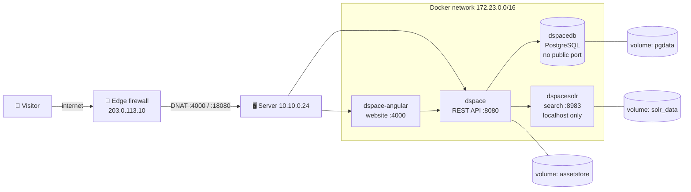

# DSpace 8 on Docker for a Research Library

Migrating a library's digital repository from a traditional server install to **Docker**, on a **shared production server** with other teams' applications. The repository was then published to the internet safely.

> All names, IP addresses and domains here are anonymised examples (`203.0.113.x`, `10.10.0.x`, `library.example.com`).

---

## 🗺️ Architecture

| Component | Image | Port (host → container) |
|---|---|---|
| Website (Angular, Node.js, PM2) | custom build of `dspace-angular` 8.0 | `4000 → 4000` |
| Backend (Java 17, embedded Tomcat) | `dspace/dspace:dspace-8.0` | `18080 → 8080` |
| Search (Solr) | `dspace/dspace-solr:dspace-8.0` | `127.0.0.1:8983` only |
| Database (PostgreSQL 15) | `dspace/dspace-postgres-pgcrypto:dspace-8.0` | not published |

---

## 🛠️ What I did

| # | Problem | Root cause | Fix |
|---|---|---|---|
| 1 | The first deployment failed with a misleading permission error | Wrong image tag, dead DNS resolver, ports already in use | Correct tags (`dspace-8.0`), fixed host DNS with `nmcli` (no restart), chose free ports and subnet |
| 2 | Data lived on the old server | — | Migrated the database (`pg_dump`) and files to Docker volumes, and verified the item counts |
| 3 | No backup | — | Daily cron backup (DB dump + files + config, 7-day rotation) and a **tested restore** in a throwaway container |
| 4 | E-mail not working | No SMTP config | SMTP settings via a bind-mounted config file (survives container re-creates) |
| 5 | Edit pages very slow (11 GB RAM) | PM2 `instances: max` started **224** copies on a 224-core host | Pinned to 4 instances with a read-only mounted config: **11 GB → 227 MB** |
| 6 | Custom branding lost on re-create | Files had been copied into the container | Moved all custom files into read-only bind mounts |
| 7 | Public users saw an error page | The UI pointed browsers to a private API address | Set the public REST host, CORS origins and server URLs |
| 8 | Outside access stopped | Traffic blocked before reaching the server | Proved it with `tcpdump` (0 packets) and Docker NAT rules, then fixed it at the edge firewall with the network team |
| 9 | Hard-to-remember address | — | Domain DNS (A + CNAME records). Next: reverse proxy and HTTPS |

---

## 🔐 Safe-change rules I followed

- Read-only checks first, **backup before every edit**, one change at a time, verify afterwards
- Never restart Docker or NetworkManager on a shared host
- Never use `docker compose down -v` or `prune --volumes`
- Secrets live only in config files, never in Git, chat or screenshots
- Re-create only the service that changed: `docker compose up -d <service>`

---

## 🧰 Skills shown

`Docker` · `Docker Compose` · `volumes & bind mounts` · `Linux networking` · `NAT / firewall` · `DNS` · `tcpdump` · `iptables` · `PostgreSQL backup & restore` · `cron` · `PM2 / Node.js` · `troubleshooting with evidence` · `documentation`

## 🚀 Next steps

- Reverse proxy (Apache) and HTTPS with Let's Encrypt
- Off-server backup copies
- Automate the health check with Ansible

---

*Author: Abdul Haleem K P · System Administrator*
